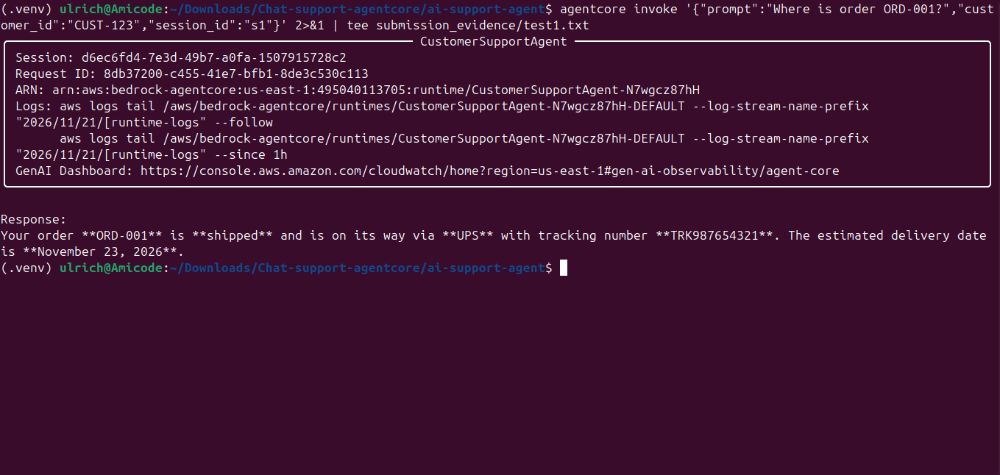
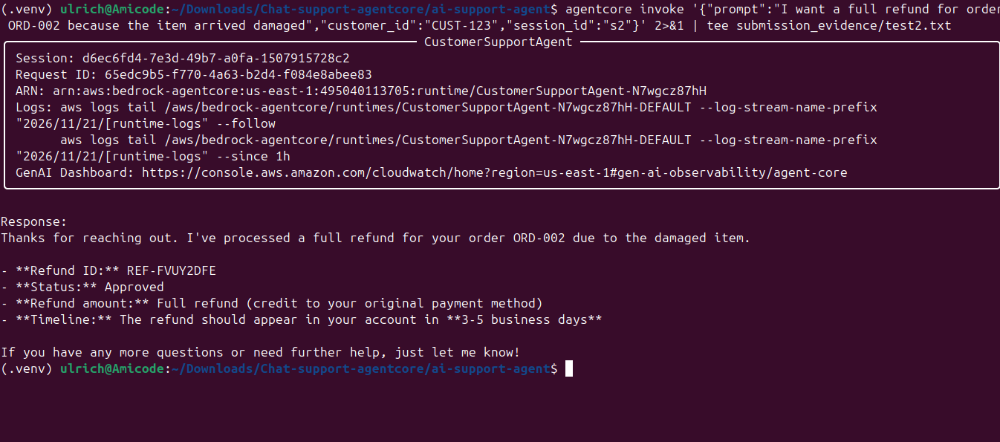
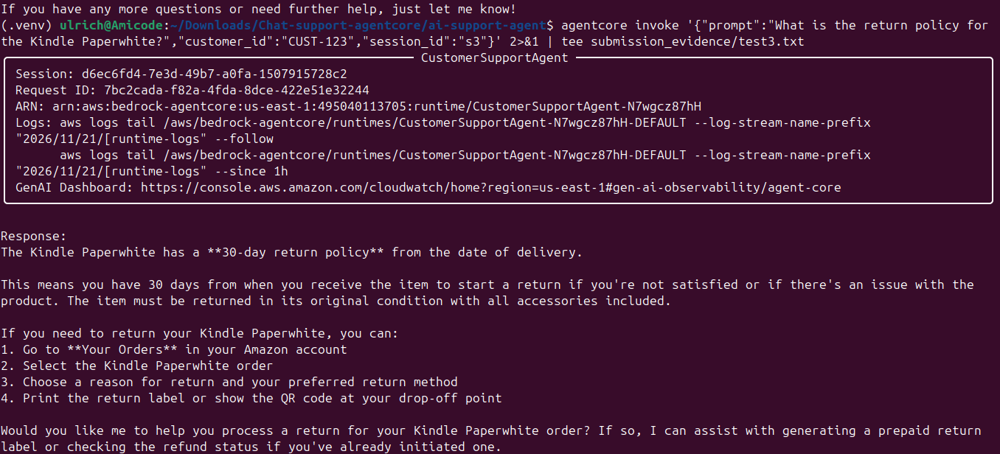
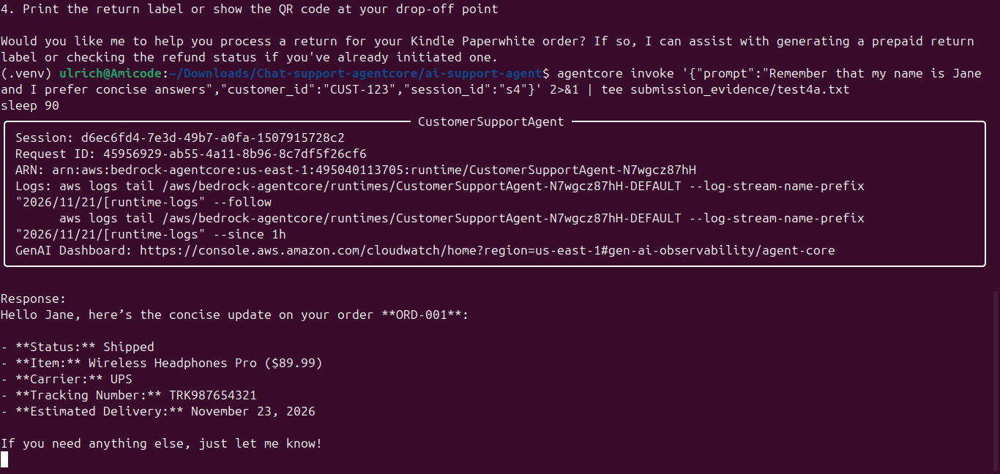
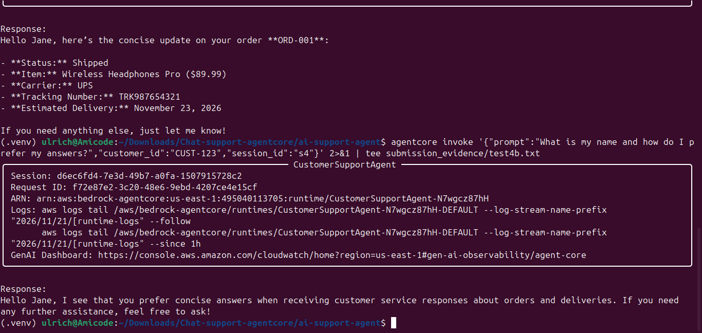
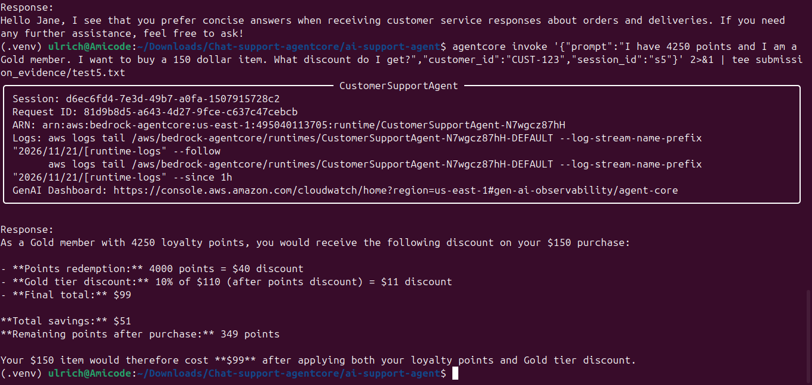
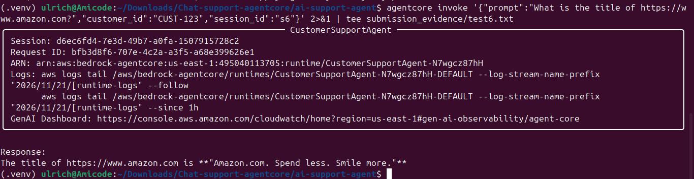

# How the System Works

This document explains what the project does, how a request moves through the system, how to test the deployed agent, and the verified output for Test 1 through Test 6.

---

## 1. Project overview

This project is a customer-support agent for a fictional Amazon store. It is deployed as a single Amazon Bedrock AgentCore Runtime. The agent receives a prompt, a customer ID, and a session ID. It then chooses the correct tool, calls the backend system, and returns a clear answer.

The agent is not just using model memory. It uses real tools:

- order and refund APIs,
- a Knowledge Base with product documents,
- Code Interpreter for loyalty math,
- AgentCore Memory for customer history,
- a remote browser for live web pages.

This makes the project a complete tool-using agent workflow.

---

## 2. Deployment context

| Setting | Value | Why it matters |
|---|---|---|
| AWS account | Withheld for privacy | This is the private AWS account that owns the resources. Testing uses the AWS CLI profile already configured on this machine. No account number is needed in the documentation. |
| Region | `us-east-1` | This is the AWS region where the runtime, Gateway, Lambda, Knowledge Base, and Memory were created. AWS resources are regional, so the region must match during testing. |
| Runtime ID | `CustomerSupportAgent-N7wgcz87hH` | This identifies the deployed agent. |
| Model | `global.amazon.nova-2-lite-v1:0` | This model reasons over the prompt and selects tools. |

The AWS account is a security and billing boundary. It is not an access key or password, but it is still deployment information, so this document does not print it. The region is safe to show because it only indicates where the services run.

---

## 3. Request flow

1. `agentcore invoke` sends a JSON payload with `prompt`, `customer_id`, and `session_id` to `invoke()` in `main.py`.
2. The memory hook loads saved facts and preferences for that customer.
3. The agent builds its tool list: three local tools and six MCP tools from the AgentCore Gateway.
4. Nova 2 Lite selects the correct tool for the prompt.
5. Strands Agents executes the tool and returns the result to the model.
6. The model writes the final customer-facing answer.
7. The assistant saves the interaction back to AgentCore Memory for future turns.

The agent does not call Lambda or API Gateway directly. Gateway MCP tools are the only path to backend order and refund data.

---

## 4. Architecture

| Layer | Service | Role |
|---|---|---|
| Runtime | Bedrock AgentCore Runtime | Hosts the agent |
| Agent loop | Strands Agents | Tool selection and response generation |
| Model | Amazon Nova 2 Lite | Reasoning and final answers |
| Backend tools | AgentCore Gateway + MCP | Exposes Lambda-backed order and refund tools |
| Backend compute | Lambda + API Gateway | Order, customer, and refund data |
| Product knowledge | Bedrock Knowledge Base + OpenSearch Serverless | RAG over `product_catalog.txt` |
| Calculations | AgentCore Code Interpreter | Exact loyalty discount math |
| Long-term memory | AgentCore Memory | Customer facts and preferences |
| Live web | AgentCore Browser + CDP | Reads live page titles |

---

## 5. Tools

### Local tools in `main.py`

| Tool | Use |
|---|---|
| `search_knowledge_base` | Product specs, return policies, warranty, loyalty tiers |
| `calculate_loyalty_discount` | Points and tier discount calculations |
| `web_browser` | Opens a live page in a remote browser and reads its title |

### Gateway tools

| Tool | Use |
|---|---|
| `order-tracker___get_order` | Look up one order |
| `order-tracker___get_customer_orders` | List orders for a customer |
| `order-tracker___get_customer` | Look up a customer profile |
| `refund-processor___initiate_refund` | Create an approved refund |
| `refund-processor___check_refund_status` | Check a refund ID |
| `refund-processor___get_return_label` | Create a return label |

Gateway URL:

```text
https://customersupportgateway-q0bnbscqkv.gateway.bedrock-agentcore.us-east-1.amazonaws.com/mcp
```

---

## 6. How to test the agent

Open a terminal in the project folder and activate the existing virtual environment:

```bash
cd /home/ulrich/Downloads/Chat-support-agentcore/ai-support-agent
source .venv/bin/activate
export PATH="$HOME/.local/share/uvtool/bin:$PATH"
export AGENTCORE_SUPPRESS_RECOMMENDATION=1
```

Check that AWS CLI credentials are active:

```bash
aws sts get-caller-identity
```

Do not paste the account number or credentials into the report. The command only confirms that the correct deployment profile is active.

Run the six tests below in order. Test 4 has two parts and must use the same `session_id`.

---

## 7. Verified tests and actual outputs

All tests used `customer_id: CUST-123`. Screenshots are in `submission_evidence/`.

### Test 1 — Order tracking

```bash
agentcore invoke '{"prompt":"Where is order ORD-001?","customer_id":"CUST-123","session_id":"s1"}'
```

**Path:** Gateway → `order-tracker` Lambda → API Gateway

**Actual output:**

```text
Your order ORD-001 has been SHIPPED and is on its way to you!

Here are the details:

- Order Status: Shipped
- Items: Wireless Headphones Pro (1 x $89.99)
- Total: $89.99
- Carrier: UPS
- Tracking Number: TRK987654321
- Estimated Delivery: November 23, 2026

You can track the package using the tracking number TRK987654321 on the UPS
website or app. If you have any questions or need further assistance, feel free
to ask!
```



---

### Test 2 — Refund

```bash
agentcore invoke '{"prompt":"I want a full refund for order ORD-002 because the item arrived damaged","customer_id":"CUST-123","session_id":"s2"}'
```

**Path:** Gateway → `refund-processor` Lambda

**Actual output:**

```text
Your refund for order ORD-002 has been approved!

- Refund ID: REF-APFMNM0S
- Status: Approved
- Credit amount: Full refund (appears in 3-5 business days)

The refund was processed because you reported the item arrived damaged. You
should see the credit reflected in your account within the next 3-5 business
days.

Is there anything else I can help you with today?
```



---

### Test 3 — Knowledge Base / RAG

```bash
agentcore invoke '{"prompt":"What is the return policy for the Kindle Paperwhite?","customer_id":"CUST-123","session_id":"s3"}'
```

**Path:** `search_knowledge_base` → Bedrock Knowledge Base → OpenSearch Serverless

**Actual output:**

```text
Based on the information I found, the return policy for the Kindle Paperwhite is
30 days from the delivery date.

This is listed under the product details for the Kindle Paperwhite (PROD-002),
which shows a "Return Policy: 30 days". This aligns with Amazon's standard
return window for most items, though note that for electronics generally, the
policy mentions a 15-day window after opening - but the specific Kindle
Paperwhite listing indicates the full 30-day return period applies.

To return your Kindle Paperwhite, you would need to:
1. Go to Your Orders in your Amazon account
2. Select the Kindle Paperwhite item you want to return
3. Choose a reason and preferred return method
4. Print the label or show QR code at the drop-off point

Would you like me to help you with initiating a return if you have your order ID?
```



---

### Test 4-1 — Save memory

```bash
agentcore invoke '{"prompt":"Remember that my name is Jane and I prefer concise answers","customer_id":"CUST-123","session_id":"s4"}'
```

**Path:** `MemoryHook` → AgentCore Memory

**Actual output:**

```text
Thanks for sharing those details, Jane. I've confirmed the status of your order
ORD-001:

Order Status: Shipped
- Item: Wireless Headphones Pro ($89.99 x 1)
- Carrier: UPS
- Tracking Number: TRK987654321
- Estimated Delivery: November 23, 2026

The order is on its way and you can track the package using the tracking number
with UPS. Let me know if you need anything else!
```

Wait about 90 seconds before Test 4-2 because memory extraction is asynchronous.



---

### Test 4-2 — Recall memory

```bash
agentcore invoke '{"prompt":"What is my name and how do I prefer my answers?","customer_id":"CUST-123","session_id":"s4"}'
```

**Path:** `MemoryHook` → AgentCore Memory → prompt enrichment

**Actual output:**

```text
Hello Jane! You prefer concise answers.
```



---

### Test 5 — Loyalty discount

```bash
agentcore invoke '{"prompt":"I have 4250 points and I am a Gold member. I want to buy a 150 dollar item. What discount do I get?","customer_id":"CUST-123","session_id":"s5"}'
```

**Path:** `calculate_loyalty_discount` → Code Interpreter

**Actual output:**

```text
As a Gold member with 4,250 loyalty points, here's the discount breakdown for
your $150 item:

- Points Redeemed: 4,000 points
- Points Value: $40
- Subtotal after points: $110

- Gold Tier Discount Rate: 10%
- Gold Tier Discount: $11

- Final Total: $99

- Total Savings: $51
- Points Earned on Purchase: 99 points
- Remaining Points: 250 points

So, you'll pay $99 after applying your loyalty points and Gold tier discount,
saving a total of $51.
```



---

### Test 6 — Browser tool

```bash
agentcore invoke '{"prompt":"What is the title of https://www.amazon.com?","customer_id":"CUST-123","session_id":"s6"}'
```

**Path:** `web_browser` → AgentCore Browser → raw CDP

**Actual output:**

```text
The title of https://www.amazon.com is "Amazon.com: Spend less. Smile more."
```



---

## 8. Key fixes included

| Problem | Fix |
|---|---|
| Playwright failed on ARM64 with `libatomic.so.1` | Replaced with raw CDP browser client |
| Amazon returned a bot-detection title | Added browser user-agent override |
| Gateway target rejected OpenAPI + API Gateway config | Used API Gateway only |
| API Gateway tools failed without responses | Added 200 method responses |
| OpenSearch index creation returned 403 | Added `x-amz-content-sha256` to SigV4 request |
| Memory recall was too early | Wait 90 seconds between Test 4-1 and Test 4-2 |
| Deploy failed because `uv` was not found | Added uv path to `PATH` |
